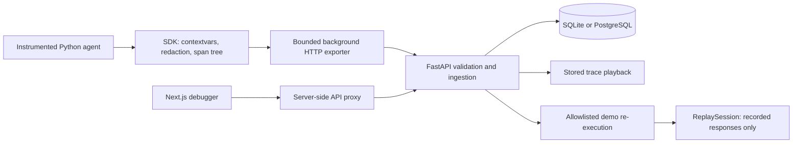

# Architecture

AgentReplay is one service, one web application, and one reusable SDK. It avoids a queue service, a separate worker fleet, or a second analytics database.

## Repository map

| Path | Responsibility |
| --- | --- |
| `packages/python-sdk/src/agentreplay` | Shared Pydantic schemas, redaction, decorators, export, strict replay |
| `apps/api/src/agentreplay_api` | App factory, request limits, authentication, SQLAlchemy storage, comparison, replay services |
| `apps/api/src/agentreplay_api/migrations` | Alembic schema history; packaged with the API |
| `apps/web/src` | Next.js App Router, same-origin proxy, debugger components and trace utilities |
| `examples/agentreplay_examples` | No-key demo, record/replay CLI, separately imported real-provider adapter |
| `tests` | Python SDK, replay, API, migration and transport tests |

## Capture model

A completed run contains one root agent span and up to 1,999 child spans. Each span has a UUID, parent UUID, start-order sequence, kind, UTC timestamps, monotonic duration, status, sanitized arguments/result, exception details, metadata, and a replayability flag. A flat, parent-linked representation supports async sibling spans without recursive payload duplication. The API validates a connected, acyclic, single-root tree, unique sequences, and timestamp containment. Spans are stored in start order, independent of completion order.

`contextvars` isolate recorder, parent, tracer and replay state across async tasks. Concurrent independent root agents produce separate runs. Await child tasks before the root agent exits. Detached work is outside this completed-run capture model. Normal recording can capture overlapping sibling tool calls; deterministic replay conservatively rejects those runs.

The default implicit tracer has a null exporter. Explicit `Tracer()` uses an in-memory transport, useful in tests. `BufferedHTTPTransport` runs a bounded daemon queue, does not retry, and counts dropped or failed deliveries. Its context manager drains on shutdown. This is a best-effort development tracer, not an audit ledger.

## Persistence and ingestion

SQLAlchemy stores indexed run summary columns plus JSON payloads. Span rows have a foreign key to their run and independently addressable payloads. The run summary omits the span array to keep listing efficient. A single transaction inserts the run and spans; duplicate IDs return 409 and roll back. PostgreSQL uses the same schema through psycopg. UTC source timestamps remain in JSON, avoiding SQLite timezone conversion issues during trace reconstruction.

Alembic upgrades on API startup. Schema definitions and migrations live together and are tested with repeated startups. This default serves one local process. Apply migrations separately before scaling to multiple API workers.

The API caps request bodies before parsing, validates Pydantic schemas, re-sanitizes captured values, and returns errors without echoing request inputs. Filter queries use SQLAlchemy bound expressions and escape wildcard search characters. The UI proxy uses a fixed configured upstream, restricted path characters, same-host write checks, a body cap, and a request timeout. The API key stays on the server.

## Debugger

The browser fetches real API data through `/api/v1/*`. Query parameters address individual runs and comparisons, so views are shareable within the local workspace. Loading, empty, API failure, and retry states are explicit. Demo actions create actual persisted traces. Replay actions persist derived runs and reports.

Timeline order follows the parent tree and start sequence. Bars show relative starts and durations. The latency breakdown subtracts the union of child intervals from each parent's inclusive time. Concurrent spans can collectively exceed wall time; the breakdown represents aggregate exclusive work, not an additive wall-clock guarantee. JSON values expand recursively and are rendered as text, never HTML.

Comparison aligns spans by full kind/name ancestry and occurrence within a parent. It reports added, removed, and modified calls, inputs, outputs, exceptions, metadata and per-span duration deltas. Volatile UUIDs and timestamps do not create behavioral differences.

## Replay boundary

Playback clones stored data and changes IDs without running code. Re-execution runs Python control flow while decorators consume recorded responses instead of calling integrations. No API accepts arbitrary code or import paths. The bundled demo registry is intentionally a single explicit allowlist entry. See [replay.md](replay.md) for precise contracts.
